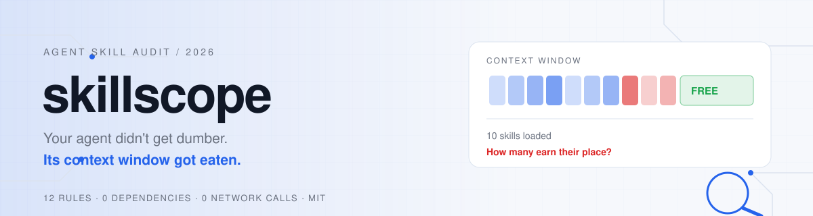
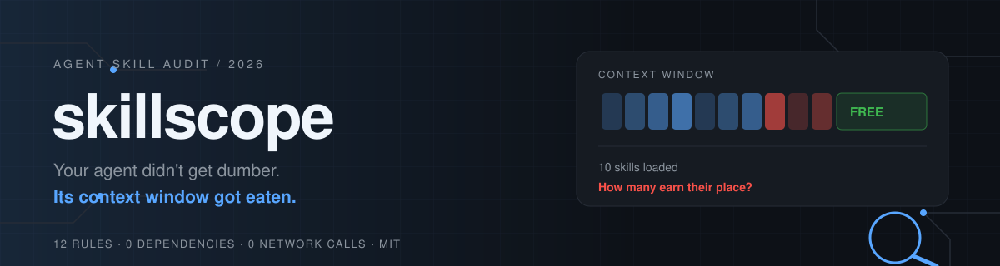
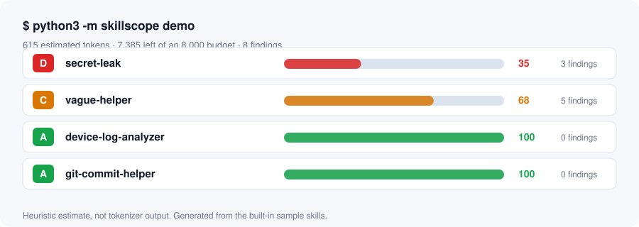
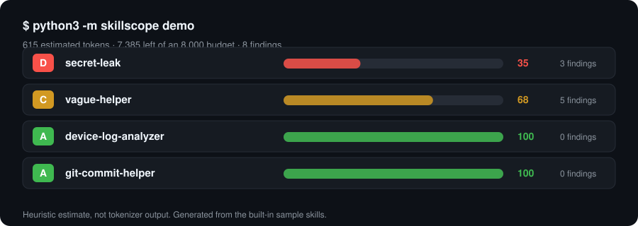

# skillscope

[](https://www.python.org/) [](pyproject.toml) [](docs/WHY-NOW.md) [](tests/) [](LICENSE) [中文 →](README.md)

## Your agent didn't get dumber. Its context window got eaten.

> **One command to expose the skills quietly draining your agent** — the ones that never fire, the ones that bloat every prompt, and the ones that shipped a credential straight into your context.
> 12 rules · 0 dependencies · 0 network calls · 0 accounts · one shareable HTML report.

Agent Skills are exploding, but almost nobody can answer three questions: **which ones deserve to stay resident, which ones are broken, and which ones should not exist at all**. While everyone ships skill collection #421, this project puts a dashboard on the whole ecosystem. No guessing, no model calls, no network — just a ruler with the markings visible.

| Without skillscope | With skillscope |
|---|---|
| Guess which skill to delete | Estimate resident cost, name the **top 3 to slim first** |
| Open every `SKILL.md` hunting broken references | Scan once; references to missing scripts **surface immediately** |
| Description says `helper`, the agent never fires it | `TRIG001` turns trigger quality into a measurable check |
| A credential hides in a file injected wholesale | `SEC001` **caps the grade at D** and fails CI |
| Anyone can drop a skill into the repo | `--fail-under 70` sets the gate in one line |

**Zero dependency. Zero network. Zero excuses.**

---

## 30-second start

```bash
cd skillscope
python3 -m skillscope demo --html report.html       # built-in samples, zero setup
python3 -m skillscope scan .                        # every SKILL.md under this directory
python3 -m skillscope scan /path/to/skills --budget 16000 --json result.json
python3 -m skillscope scan ./skills --fail-under 70  # CI gate
python3 -m skillscope rules
```

No upstream clone, no GitHub token, no API key, no network. Python 3.9+ is all you need.

## What one command actually catches

Real output of `python3 -m skillscope demo` (2 good + 2 deliberately broken samples):




```text
级   分     Skill                          估算 tok       问题
D   35    secret-leak                    103          3
C   68    vague-helper                   47           5
A   100   device-log-analyzer            288          0
A   100   git-commit-helper              177          0
合计估算常驻成本 615 tok  |  预算剩余 7,385 tok  |  问题 8 条
  [ERROR] secret-leak SEC001 -> 删除凭据；若是占位符，改成 <YOUR_TOKEN> 这类不可执行写法
  [ERROR] vague-helper FM002 -> 补 name: <小写连字符标识>
```

- A skill with a hard-coded credential in its body → **D / 35**, hard-capped; no other points can rescue it.
- A skill missing `name`, described only as `helper`, referencing a script that does not exist → **C / 68**.
- Two well-formed samples → **A / 100 / 0 findings**.
- **Dogfooding**: `python3 -m skillscope scan SKILL.md` → this repo scores **A / 100 / 0 findings / 233 estimated tokens**.

See the [generated sample report](examples/sample-report.html): score table, cost bars, per-finding fixes, rule catalog — a single self-contained file with no CDN.

## What it checks

Scoring is fully transparent: `100 - sum(error 14 / warn 7 / info 2)`. Grades: A≥85, B≥70, C≥50, D<50. **A `SEC001` credential hit caps the grade at D** — security is not something other points can offset.

| Rule | Level | Check |
|---|---|---|
| FM001 / FM002 / FM003 | error | frontmatter block, `name`, `description` present |
| TRIG001 / TRIG002 | warn | trigger clarity; overlong description |
| SIZE001 / SIZE002 | warn / info | progressive disclosure into `references/` |
| REF001 | warn | referenced `scripts/` `tools/` `references/` files exist |
| SEC001 | error | token / private key / inline secret (**caps at D**) |
| DUP001 | warn | near-duplicate descriptions (Jaccard ≥ 0.75) |
| META001 | info | `version` present |
| DEMO001 | info | a reproducible example with no credentials |

Plus: **context budget** (`--budget`, warns when negative), **top 3 skills to slim first**, **JSON + HTML output**, and a **CI gate** via `--fail-under`.

---

## Straight talk (the loud copy stops here)

- **Token counts are a heuristic, not tokenizer output**: CJK / kana / hangul ≈ 1 char per token, everything else ≈ 4 chars per token. Use them for *relative* comparison and a rough budget only. **Do not use them for billing.**
- **Scoring is a rule deduction, not a model judgement** — no hidden weights, no remote calls, no "AI-powered assessment" wrapping.
- **Fully offline**: reads local files only, uploads nothing, needs no credentials.
- **The tool neither fetches nor generates star / fork / delta numbers.** GitHub figures below come from a timestamped snapshot.
- The `secret-leak` sample contains an obviously fake placeholder (`ghp_` plus only `X` characters) used solely to exercise the detector.
- Roadmap items are **not implemented** and are not presented as existing features.

## Why now

On 2026-11-14, GitHub Trending was dominated by AI coding agents / Agent Skills / MCP. Every number below comes from a real snapshot taken that day; stars and deltas come from two different sources at two different times and are labelled separately. Full provenance, conflict handling and the fact/opinion boundary live in [docs/WHY-NOW.md](docs/WHY-NOW.md).

| Repo | Stars (REST, 22:36:32) | Official delta (Trending page, 22:32:30) |
|---|---:|---:|
| `anthropics/skills` | 194,421 | +6,169 this week |
| `addyosmani/agent-skills` | 117,403 | +3,502 this week |
| `vercel-labs/agent-browser` | 50,995 | +4,360 this week |
| `ChromeDevTools/chrome-devtools-mcp` | 56,028 | +673 today |
| `JuliusBrussee/caveman` | 119,838 | +227 today |
| `GoogleChrome/modern-web-guidance-src` | 5,477 | +1,225 today |

Times are GMT+8, 2026-11-14. Stars come from `https://api.github.com/repos/{owner}/{repo}`; deltas are the official labels on `https://github.com/trending?since=daily|weekly`. Snapshots drift — check the raw data before quoting.

**Opinion, not a fact**: `caveman` reaching 119,838 stars on one "cut token spend" hook proves the cost anxiety is real and shareable. skillscope does not clone it — it answers the upstream question: **which skills are worth cutting at all**.

---

## Layout

```text
skillscope/
├── SKILL.md                     # this repo is itself an Agent Skill (self-scan: 100)
├── assets/                      # dual-theme banner/scorecard SVG + OG cards PNG + generator
├── skillscope/                  # Python package, zero third-party dependencies
│   ├── frontmatter.py           # minimal YAML frontmatter parser
│   ├── scan.py                  # SKILL.md discovery
│   ├── rules.py                 # 12 rules + scoring + security hard gate
│   ├── tokens.py                # heuristic tokens / budget
│   ├── report.py                # self-contained HTML report
│   ├── cli.py                   # scan / demo / rules
│   └── samples/                 # 2 good + 2 broken built-in samples
├── tests/                       # 25 unittest cases
├── examples/                    # pre-generated HTML / JSON
├── docs/
│   ├── WHY-NOW.md               # trend data provenance
│   ├── DISCUSSION-en.md         # upstream discussion posts (EN / 中文)
│   └── SOCIAL-PREVIEW.md        # OG card spec + upload notes
├── README.md                    # 中文
├── pyproject.toml
└── LICENSE (MIT)
```

## Tests

```bash
python3 -m unittest discover -s tests -v     # 25 tests, OK
```

## Further reading

- [Why now](docs/WHY-NOW.md) — facts and opinions kept apart; every number carries its source and fetch time
- [Upstream Discussions post · English](docs/DISCUSSION-en.md) / [中文](docs/DISCUSSION-zh.md) — copy-paste body plus publishing rules and target communities (**draft only, not published**)
- [Social preview](docs/SOCIAL-PREVIEW.md) — OG card spec, regeneration, upload path and verification

## Roadmap (planned, not implemented)

`--diff` between scans, optional real tokenizer (explicitly labelled), pluggable rules from `rules.d/`, offline replay tests for trigger descriptions.

## License

MIT — see [LICENSE](LICENSE).
