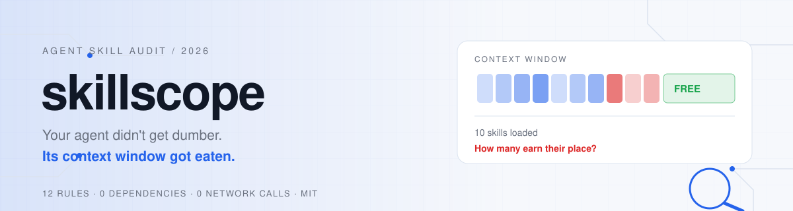
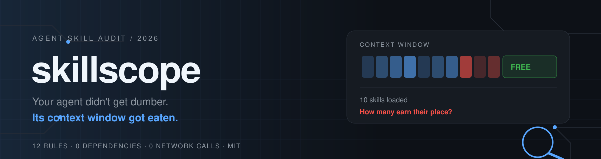
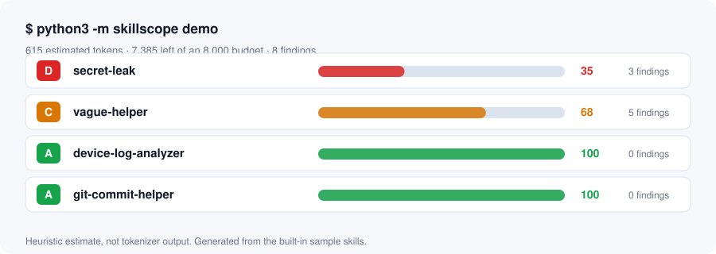
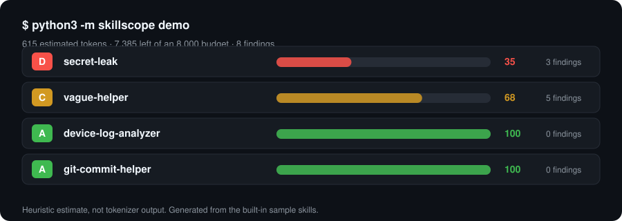

# skillscope

[](https://www.python.org/) [](pyproject.toml) [](docs/WHY-NOW.md) [](tests/) [](LICENSE) [English →](README.en.md)

## 你的 Agent 没变笨。是它的上下文窗口被 Skill 吃满了。

> **一条命令，把拖慢 Agent、抢错触发、甚至把密钥写进上下文的 Skill 全部揪出来。**
> 12 条规则 · 0 依赖 · 0 网络请求 · 0 账号 · 一份能直接发给团队的 HTML 报告。

Agent Skills 正在爆发式增长，可几乎没人回答得了三个问题：**哪些该常驻、哪些写坏了、哪些根本不该存在**。
别人在生产第 421 个 Skill 合集，我们给整个生态装了一块仪表盘 —— 不靠猜、不靠模型、不联网，一把刻度公开的尺子。

| 现在的你 | 装上 skillscope 之后 |
|---|---|
| 靠感觉猜哪个 Skill 该删 | 估算常驻成本，直接点名**最该先瘦身的 3 个** |
| 一个个点开 `SKILL.md` 找坏引用 | 一次扫完，指向不存在脚本的引用**当场抓出** |
| 触发条件写成 `helper`，Agent 永远不唤起 | `TRIG001` 把「会不会被唤起」变成可量化项 |
| 凭据混进会被整体注入的文件，没人发现 | `SEC001` 命中**直接封顶 D**，CI 当场挂掉 |
| 谁都能往仓库里塞一个 Skill，没有门槛 | `--fail-under 70` 一行命令设闸 |

**Zero dependency. Zero network. Zero excuses.**

---

## 30 秒上手

```bash
cd skillscope
python3 -m skillscope demo --html report.html      # 内置样本，零配置
python3 -m skillscope scan .                       # 扫当前目录所有 SKILL.md
python3 -m skillscope scan /path/to/skills --budget 16000 --json result.json
python3 -m skillscope scan ./skills --fail-under 70 # CI 卡口
python3 -m skillscope rules                        # 列出全部规则
```

不需要 clone 上游、不需要 GitHub token、不需要 API key、不需要联网。Python 3.9+ 直接跑。

## 一条命令能抓出什么

`python3 -m skillscope demo` 的真实输出（内置 2 好 2 坏样本）：




```text
级   分     Skill                          估算 tok       问题
D   35    secret-leak                    103          3
C   68    vague-helper                   47           5
A   100   device-log-analyzer            288          0
A   100   git-commit-helper              177          0
------------------------------------------------------------------------------
合计估算常驻成本 615 tok  |  预算剩余 7,385 tok  |  问题 8 条
  [ERROR] secret-leak SEC001 -> 删除凭据；若是占位符，改成 <YOUR_TOKEN> 这类不可执行写法
  [ERROR] vague-helper FM002 -> 补 name: <小写连字符标识>
```

- 一个把凭据硬编码进正文的 Skill → **D / 35**，安全项封顶，其它分数救不回来。
- 一个缺 `name`、描述只有 `helper`、还引用了不存在脚本的 Skill → **C / 68**。
- 两个规范样本 → **A / 100 / 0 问题**。
- **自举**：`python3 -m skillscope scan SKILL.md` → 本仓库自己拿 **A / 100 / 0 问题 / 233 tok**。

先看 [示例审计报告](examples/sample-report.html)：评分表、成本条形图、逐条问题与建议动作、规则目录，单文件无 CDN。

## 它到底检查什么

评分完全透明：`100 − Σ(error 14 / warn 7 / info 2)`，A≥85 / B≥70 / C≥50 / D<50。**命中 `SEC001` 直接封顶 D** —— 安全项不允许被其它得分抵消。

| 规则 | 级别 | 检查项 |
|---|---|---|
| FM001 / FM002 / FM003 | error | frontmatter 块、`name`、`description` 是否齐全 |
| TRIG001 / TRIG002 | warn | 触发条件是否清晰；description 是否过长 |
| SIZE001 / SIZE002 | warn / info | 正文是否该拆到 `references/` 做渐进披露 |
| REF001 | warn | 正文引用的 `scripts/` `tools/` `references/` 文件是否真实存在 |
| SEC001 | error | 疑似 token / 私钥 / 内联口令（**封顶 D**） |
| DUP001 | warn | 与其它 skill 的描述是否近重复（Jaccard ≥ 0.75） |
| META001 | info | 是否带 `version` |
| DEMO001 | info | 有没有无需凭据即可复现的示例 |

在报告之外还给你：

- **上下文预算**：`--budget` 设上限；为负数时明确警告「任务还没开始，窗口已被 Skill 吃满」。
- **瘦身优先级 TOP 3**：按估算成本排序，直接给可执行目标，不给空泛建议。
- **JSON + HTML 双输出**：`--json` 接看板/CI，`--html` 交付可留存报告。
- **CI 卡口**：`--fail-under 70` 让不合格 Skill 进不了主分支。

---

## 诚实声明（吹得再响，这几条不让步）

- **token 是启发式估算，不是任何模型 tokenizer 的实测结果**：CJK / 假名 / 韩文约 1 字 1 token，其余约 4 字符 1 token。只用于 Skill 之间的**相对比较**和粗略预算，误差可能很大，**不要拿它算钱**。
- **评分是规则扣分，不是模型判断**：没有隐藏权重、没有远程调用、没有「AI 智能评估」这种包装。
- **全程离线**：只读本地文件，不联网、不上传任何 Skill 内容、不需要任何凭据。
- **本工具不抓取也不生成 star / fork / 增量数字**。下文出现的 GitHub 数字全部来自标注了来源与抓取时间的真实快照。
- 内置 `secret-leak` 样本里是一串明显为假的占位符（`ghp_` + 全 `X`），仅用于验证检测规则，不是真实凭据。
- 路线图里的功能**尚未实现**，不冒充已有能力。

## 为什么是现在

2026-11-14 的 GitHub Trending 上，**「AI 编码智能体 / Agent Skills / MCP」几乎霸屏**。下面数字全部来自当天真实抓取，不是估计值；star 总数与增量来自两个不同来源、不同时刻，已分别标注（完整依据、冲突处理与「事实 / 判断」边界见 [docs/WHY-NOW.md](docs/WHY-NOW.md)）：

| 仓库 | 在做什么 | star 总数（REST，22:36:32） | 官方增量（Trending 页，22:32:30） |
|---|---|---:|---:|
| `anthropics/skills` | Agent Skills 官方仓库 | 194,421 | 周增 6,169 |
| `addyosmani/agent-skills` | 工程化 skills 合集 | 117,403 | 周增 3,502 |
| `vercel-labs/agent-browser` | 给 agent 用的浏览器 CLI | 50,995 | 周增 4,360 |
| `ChromeDevTools/chrome-devtools-mcp` | 给 agent 用的 DevTools MCP | 56,028 | 日增 673 |
| `JuliusBrussee/caveman` | 省 token 的 skill + proxy | 119,838 | 日增 227 |
| `GoogleChrome/modern-web-guidance-src` | 给 coding agent 喂最新规范 | 5,477 | 日增 1,225 |

> 抓取时间均为 2026-11-14 GMT+8。star 数来自 `https://api.github.com/repos/{owner}/{repo}`，增量来自 `https://github.com/trending?since=daily|weekly` 官方标注。快照会漂移，引用请以原始数据文件为准。

**判断（非事实）**：`caveman` 靠「省 token」这一个具体痛点做到 119,838⭐，说明成本焦虑是真实且可传播的。skillscope 不复制它，而是回答更上游的问题 —— 「到底该省谁」。

---

## 目录结构

```text
skillscope/
├── SKILL.md                     # 本仓库自身就是一个 Agent Skill（自举 100 分）
├── assets/                      # 双主题 banner + demo 评分卡（SVG）
├── skillscope/                  # Python 包，零第三方依赖
│   ├── frontmatter.py           # 极简 YAML frontmatter 解析
│   ├── scan.py                  # 发现 SKILL.md
│   ├── rules.py                 # 12 条规则 + 打分 + 安全硬封顶
│   ├── tokens.py                # 启发式 token / 预算估算
│   ├── report.py                # 自包含 HTML 报告
│   ├── cli.py                   # scan / demo / rules
│   └── samples/                 # 2 好 + 2 坏内置样本
├── tests/                       # 25 个 unittest 用例
├── examples/                    # 已生成好的示例 HTML / JSON
├── docs/WHY-NOW.md              # 选题依据：真实热度数据 + 来源 + 判断边界
├── README.en.md
├── pyproject.toml
└── LICENSE (MIT)
```

## 测试

```bash
python3 -m unittest discover -s tests -v     # 25 tests, OK
```

## 路线图（计划，尚未实现）

`--diff` 两次扫描对比、可选接入真实 tokenizer（显式标注）、`rules.d/` 插件式规则、触发条件的离线回放测试。

## 许可

MIT，见 [LICENSE](LICENSE)。
