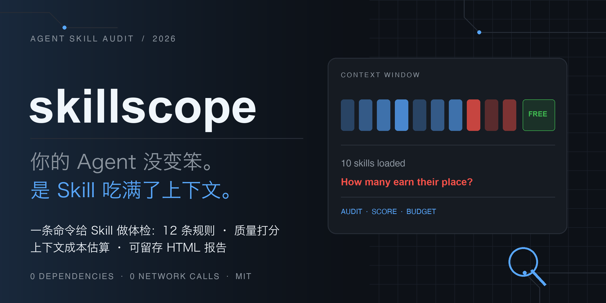

# 实际发布正文 · HelloGitHub 推荐项目 #4361

- **链接**：https://github.com/521xueweihan/HelloGitHub/discussions/4361
- **仓库 / 分类**：`521xueweihan/HelloGitHub` / 推荐项目
- **作者**：`yunloong-Y`
- **发布时间**：2026-11-15T02:19:35Z（2026-11-15 10:19:35 CST，GMT+8）
- **校验**：发布后用 GraphQL 回读，正文与下方文本完全一致（1,809 字符、2 个代码块）。

相对 `DISCUSSION-zh.md` 草稿做了四处适配（均在草稿发布说明允许范围内）：

1. 标题按社区惯例改为「【开源自荐】…」格式；
2. 删掉「为什么是现在」的 GitHub Trending 元讨论段（在项目推荐区偏题）；
3. 开头加一句自荐语境：独立工具、与任何上游无关、不是来提功能或求合并；
4. 加中文版分享卡片头图，并把「show & tell」措辞统一为「自荐」。

由于该分类本身就是自荐区，本地草稿的「目标上游清单 / 发布纪律」等说明段按原设计未粘贴。

---

## 【开源自荐】skillscope：一条命令给 Agent Skill 做体检（12 条规则 + 上下文成本估算）



你的 Agent 没变笨。是它的上下文窗口被 Skill 吃满了。

看到「推荐项目」里不少自荐帖，也来交个作业：这是我写的独立小工具，跟任何上游项目都没有关系，也不是来提功能或求合并的。

`SKILL.md` 说到底「只是个 Markdown」——没有编译器，没有 linter，也没人告诉你它到底占多少上下文。可每装一个 skill，它就会被整体注入上下文窗口。我自己反复踩到三个坑：

- 触发条件写得含糊的 skill，要么什么都触发，要么永远不触发；
- 本来该写成 200 字主文件 + `references/` 渐进披露的，被写成了 2,000 行常驻长文；
- 装到十几个 skill 之后，只觉得「Agent 变笨了」，却说不出该先删哪三个。

于是写了 **skillscope**：一个纯本地的 Agent Skill 体检工具。

- **12 条规则**：frontmatter、触发描述、渐进披露、引用文件是否存在、近重复、凭据泄露等。评分刻意做得透明且无聊：`100 − Σ(error 14 / warn 7 / info 2)`；命中凭据泄露直接封顶 D，不看分数。
- **上下文成本估算 + 预算**：`--budget 8000` 会告诉你还剩多少 token、最该先给哪几个 skill 瘦身。
- **可留存 HTML 报告**：能存档、能 diff、能贴在评审里 —— 和我给上游 PR 写汇总报告用的是同一套格式。
- **可进 CI**：`--fail-under 70` 不达标就非零退出。

**零第三方依赖、零网络请求、不需要任何账号或 token**。它同时是 CLI 和 Skill（仓库根目录自己的 `SKILL.md` 自举扫描拿到 A / 100 分 / 0 问题）。

```bash
git clone https://github.com/yunloong-Y/skillscope.git && cd skillscope
python3 -m skillscope demo --html report.html
python3 -m unittest discover -s tests -v          # 25 tests
```

`demo` 零配置，内置了几个故意写坏的样本。今天实测输出：

```
级   分     Skill                          估算 tok       问题
D   35    secret-leak                    103          3
C   68    vague-helper                   47           5
A   100   device-log-analyzer            288          0
A   100   git-commit-helper              177          0
------------------------------------------------------------------------------
合计估算常驻成本 615 tok  |  预算剩余 7,385 tok  |  问题 8 条
```

**边界先说清楚，毕竟这是个度量工具**：token 是*启发式估算*，不是 tokenizer 实测值，别拿去算钱；分数是规则扣分，不是模型判断；它只读本地文件，不抓也不生成任何 star 数字。你觉得哪条规则不合理，正是我最想要的 issue。


我给上游提过 128 个 PR、合并 47 个（GitHub search 可核），习惯的是「先读贡献指南、一个 PR 只解决一个问题」那套，所以这篇是来求拍砖的自荐，不是发布通告。中英双 README，MIT，永远离线。

**最想听到的三件事**：还缺哪条规则、你会不会真的把分数接进 CI、以及你们那边一个合理的「上下文预算」默认值大概是多少。
